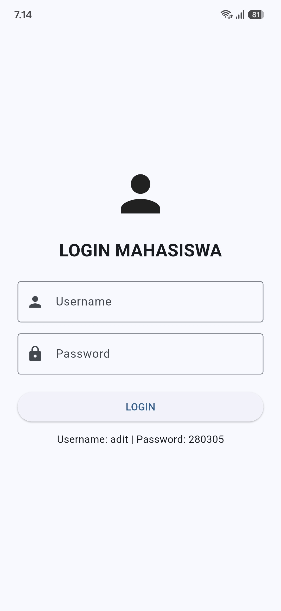
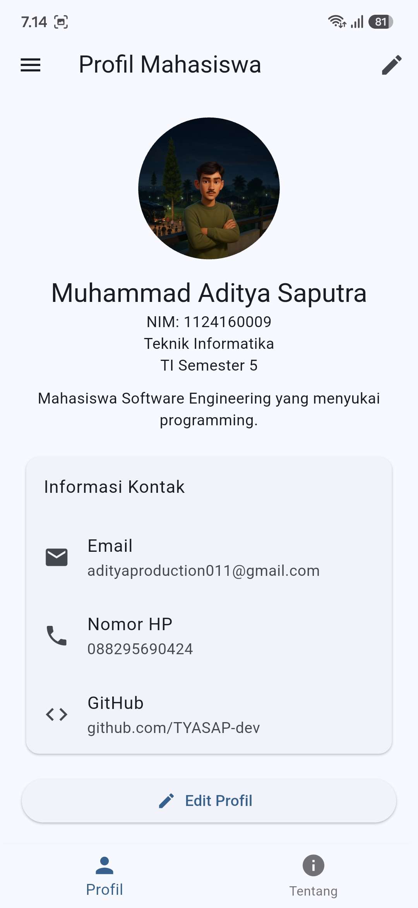
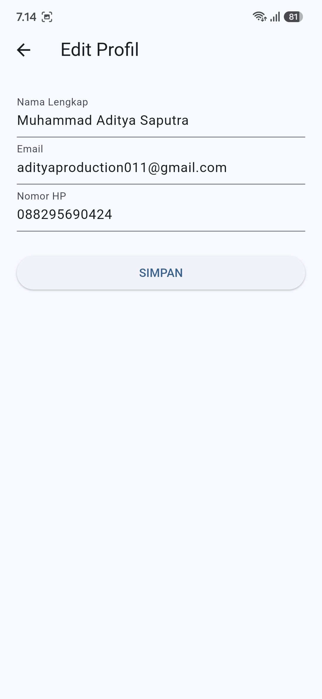
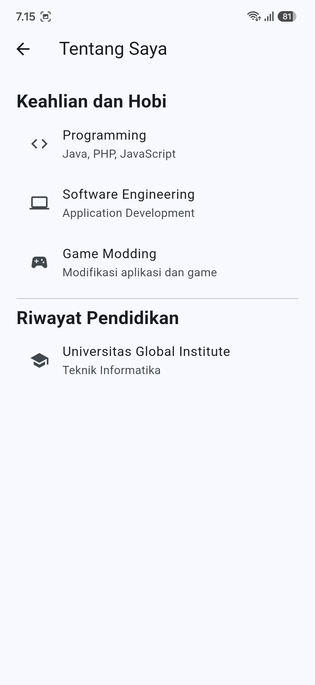
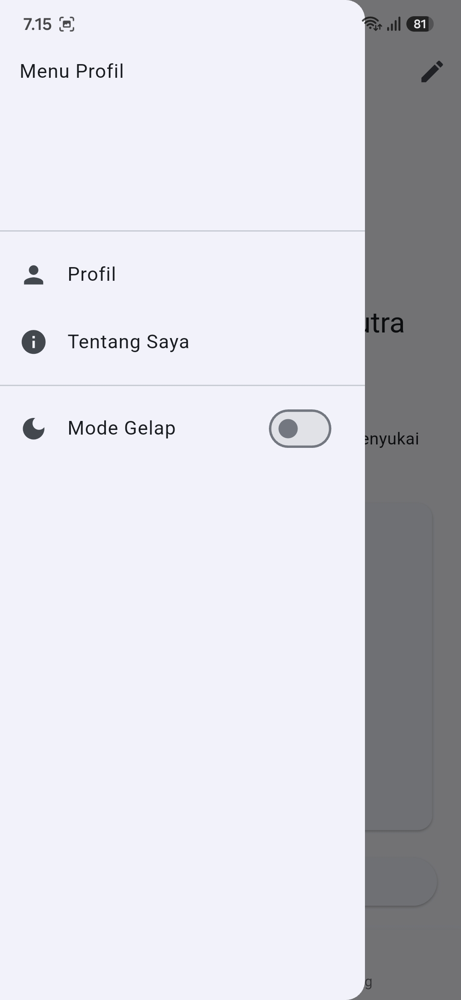
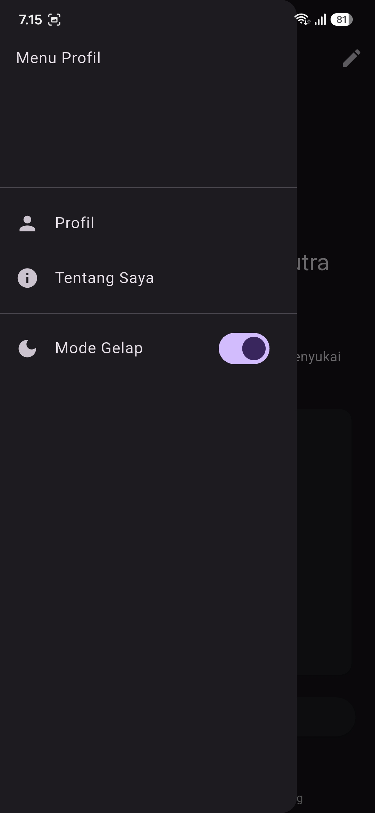

# UTS Pemrograman Mobile Lanjutan – uts-pml-1124160009

Repository ini berisi hasil Ujian Tengah Semester (UTS) mata kuliah **Pemrograman Mobile Lanjutan** (Flutter), Semester Ganjil TA 2026–2027.

## Identitas

| Informasi | Keterangan |
| :--- | :--- |
| **Nama** | Muhammad Aditya Saputra |
| **NIM** | 1124160009 |
| **Program Studi** | Teknik Informatika |
| **Kelas** | TI Semester 5 |
| **Dosen** | I Ketut Gunawan, S.Kom., M.T |
| **GitHub** | [TYASAP-dev](https://github.com/TYASAP-dev) |


## Video Presentasi

▶️ **[UTS PML – Aplikasi Profil – Muhammad Aditya Saputra – 1124160009](https://youtu.be/zGHSfwbNpKw)**

## Struktur Repository

```
uts-pml-1124160009/
├── soal1-live-coding/          # Soal 1 – Live Coding (StatelessWidget)
│   └── lib/
│       ├── main.dart
│       └── profilepage.dart
├── soal2-profil-app/
│   └── soal2uts/               # Soal 2 – Proyek Flutter Aplikasi Profil
│       ├── assets/images/profile.jpg
│       └── lib/ (main, models, screens, widgets)
├── screenshots/                # Screenshot aplikasi Soal 2
└── README.md
```

---

## Soal 1 – Live Coding: Halaman Profil Mahasiswa

Halaman profil statis (tanpa login) yang dikerjakan **hanya dengan `StatelessWidget`** (tanpa `StatefulWidget` dan `setState()`), dikerjakan dalam 3 tahap commit.

| Tahap | Isi |
|---|---|
| 1 – MaterialApp | `title`, `debugShowCheckedModeBanner: false`, `theme` dan `darkTheme` Material 3, `themeMode: ThemeMode.system`, `home: ProfilePage` |
| 2 – Scaffold dan kepala profil | `AppBar` + `actions`, `SafeArea` → `SingleChildScrollView` → `Padding` → `Column`, `CircleAvatar`, nama, NIM, dan program studi |
| 3 – Kartu informasi | Widget reusable `InfoTile` (const, parameter `final`), Card Kontak dan Card Keahlian/Hobi, `FloatingActionButton` + `SnackBar` lewat `ScaffoldMessenger` |

**Cara menjalankan:**

```bash
cd soal1-live-coding
flutter pub get
flutter run
```

---

## Soal 2 – Aplikasi Profil Mahasiswa (Android)

Aplikasi Flutter Android yang menampilkan profil diri, lengkap dengan login, edit profil, halaman tentang saya, dan mode gelap. Nama aplikasi di HP diatur lewat `android:label` pada `AndroidManifest.xml`.

### Screenshot

| Login | Profil | Edit Profil |
|:---:|:---:|:---:|
|  |  |  |

| Tentang Saya | Drawer | Mode Gelap |
|:---:|:---:|:---:|
|  |  |  |

### Daftar Fitur

- **Halaman Login**
  - `StatefulWidget` dengan `Form` + `validator` (username wajib diisi, password minimal 6 karakter).
  - Indikator loading dengan proses asynchronous (`Future.delayed`).
  - Login berhasil memakai `pushReplacementNamed`, sehingga halaman login tidak bisa dikembalikan dengan tombol back.
  - Login gagal menampilkan `SnackBar`.
- **Halaman Profil**
  - Foto dari `assets/images/` (terdaftar di `pubspec.yaml`) dalam `CircleAvatar`.
  - Nama lengkap, NIM, program studi, kelas, dan bio singkat.
  - Kontak (email, nomor HP, GitHub) dengan `Card` + `ListTile` + ikon lewat widget reusable `InfoTile`.
- **Halaman Edit Profil**
  - Nilai awal form dari `TextEditingController`.
  - Validasi: nama wajib diisi, email harus valid, nomor HP hanya angka 10–13 digit.
  - Tombol **Simpan** mengirim data baru dengan `Navigator.pop(context, dataBaru)`, lalu Halaman Profil langsung diperbarui dengan `setState()`.
- **Halaman Tentang Saya** – keahlian/hobi dan riwayat pendidikan dengan `ListView`.
- **Scaffold lengkap** – `AppBar` dengan aksi edit, `Drawer`, dan `BottomNavigationBar`.
- **Tema** – `theme` (seed biru) dan `darkTheme` (seed deep purple), Material 3. Switch **Mode Gelap** di drawer mengubah `themeMode` secara langsung.
- **Routes** – `/profile` dan `/about` terdaftar di `MaterialApp`.

### Akun Login (Demo)

| Username | Password |
|---|---|
| `adit` | `280305` |

> Data hanya disimpan di memori (tanpa server/database), sehingga perubahan profil kembali ke awal saat aplikasi ditutup.

### Struktur Kode

```
soal2-profil-app/soal2uts/lib/
├── main.dart                     # MaterialApp, tema, routes, themeMode
├── models/
│   └── profile.dart              # class Profile
├── screens/
│   ├── login_page.dart           # Form login + validator + loading
│   ├── profile_page.dart         # Halaman utama (Scaffold, drawer, bottom nav)
│   ├── edit_profile_page.dart    # Form edit + Navigator.pop(dataBaru)
│   └── about_page.dart           # Keahlian/hobi dan pendidikan (ListView)
└── widgets/
    └── info_tile.dart            # Widget reusable InfoTile
```

### Paket yang Digunakan

Tidak ada paket tambahan selain `flutter` dan `cupertino_icons`.

### Cara Menjalankan

Prasyarat: Flutter SDK, Android SDK (termasuk NDK), serta HP Android atau emulator.

```bash
git clone https://github.com/TYASAP-dev/uts-pml-1124160009.git
cd uts-pml-1124160009/soal2-profil-app/soal2uts
flutter pub get
flutter run
```

### Build APK

```bash
flutter build apk --release
```

File hasil build: `build/app/outputs/flutter-apk/app-release.apk`

📦 **Unduh APK siap pakai:** [GitHub Releases – v1.0.0](https://github.com/TYASAP-dev/uts-pml-1124160009/releases/tag/v1.0.0)

---

## Catatan

- Folder `build/`, `.dart_tool/`, dan file lokal lain tidak di-commit (memakai `.gitignore` bawaan Flutter).
- File APK tidak di-commit ke repository, hanya diunggah ke GitHub Releases.
